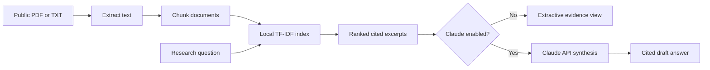

# Healthcare AI Research Assistant

[](https://github.com/USERNAME/healthcare-ai-delivery-assistant/actions/workflows/ci.yml)

**Portfolio prototype — not a production healthcare application, not medical advice, not HIPAA-certified.** Replace `USERNAME` above after publishing.

An evidence-grounded literature research assistant built to showcase forward-deployed AI delivery: problem discovery, scoped MVP, citations, optional Claude synthesis, MCP tooling, automated tests, delivery roadmap, and a transparent ROI model. This is an independently designed portfolio project, **not** a Provectus or enterprise client engagement.

## What works today
- Upload UTF-8 `.txt` and text-based `.pdf` research documents.
- Chunk and retrieve passages using local, dependency-free TF-IDF cosine similarity.
- Show extractive evidence with source chunk markers without an API key.
- Optionally generate a Claude summary with evidence-only instructions and citation markers (requires your own API key and network access).
- Run an optional MCP stdio server exposing search over a bundled **synthetic** demo corpus.
- Run tests in GitHub Actions.

**Not included:** embeddings/vector database, AWS Bedrock deployment, user accounts, persistent storage, clinical validation, enterprise security/compliance controls, automated claim verification, or a production SLA. Citations are requested from the model but not independently verified. These are future roadmap items, not delivered features.

## Quick start (Python 3.10+)

```bash
python -m venv .venv
# macOS/Linux:
source .venv/bin/activate
# Windows PowerShell:
# .venv\Scripts\Activate.ps1
python -m pip install -e '.[app,dev]'
streamlit run app.py
```

Upload `data/sample_research.txt`, then ask: **What do the notes say about EGFR and L858R?**

By default the app uses **extractive mode** (no paid API and no AI-generated synthesis).

### Enable Claude (optional)

```bash
# macOS/Linux
export ANTHROPIC_API_KEY='your-key'
# Windows PowerShell
# $env:ANTHROPIC_API_KEY='your-key'
streamlit run app.py
```

Select the Claude checkbox. The default model is `claude-sonnet-4-5`, configurable via `CLAUDE_MODEL`; choose a model your account supports. Anthropic API usage may incur costs. Uploaded evidence passages are sent to Anthropic when Claude is enabled. Never upload patient data, PHI, proprietary documents, or secrets.

### Run tests

```bash
python -m pip install -e '.[dev]'
python -m pytest -q
```

### Optional MCP tool

```bash
python -m pip install -e '.[mcp]'
python mcp_server.py
```

Example MCP client configuration (adjust absolute path and Python executable):

```json
{
  "mcpServers": {
    "healthcare-literature-demo": {
      "command": "/absolute/path/to/.venv/bin/python",
      "args": ["/absolute/path/to/healthcare-ai-delivery-assistant/mcp_server.py"]
    }
  }
}
```

The MCP server uses only bundled synthetic notes and is **not** connected to the Streamlit uploads.

## System architecture



## Product ownership artifacts

- [Product requirements and personas](docs/PRD.md)
- [Client discovery and use case validation](docs/DISCOVERY.md)
- [Agile backlog and release plan](docs/BACKLOG.md)
- [Engagement scope and acceptance](docs/SOW.md)
- [Evaluation strategy and safety](docs/EVALUATION.md)
- [ROI model and illustrative scenario](docs/ROI.md)
- [Risk register](docs/RISKS.md)
- [AWS deployment architecture proposal](docs/ARCHITECTURE.md)
- [Executive case study](docs/CASE_STUDY.md)

## Data handling and limitations

Uploads are processed in the app process memory; the project does not intentionally persist them. In hosted environments, operators must independently assess infrastructure logging, caching, retention, access controls, and privacy requirements. PDF extraction does not perform OCR. File limits are 8 MB/file and 80 PDF pages; these are application guardrails, not security assurances. TF-IDF is lexical, not semantic; relevance scores are not confidence or factual correctness. Model-generated citations may be inaccurate; review original documents. This project is not suitable for clinical decisions.

## Publishing to GitHub

1. Create a **public** repository named `healthcare-ai-delivery-assistant`.
2. Extract the ZIP and upload the **contents of the project folder** to the repository (or `git init`, `git add .`, `git commit`, and push).
3. Replace `USERNAME` in the CI badge URL.
4. Never commit `.env`, API keys, or private documents.
5. Add a screenshot of the app after running it, and link to your own demo if you deploy it.

## Portfolio attribution

Designed as a job-search portfolio example. Claims about deployment, user adoption, ROI, and clinical validity must be supported by real evidence before presenting them as achieved outcomes.

MIT licensed. See [LICENSE](LICENSE).
